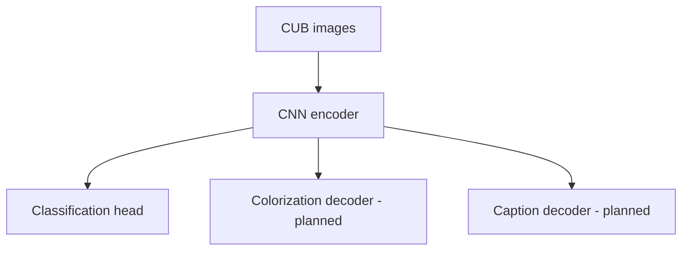

# From Pixels to Language

**FeatherLens: a PyTorch project for bird classification, image colorization and caption generation.**

We use CUB-200-2011 to study how CNN representations learned for fine-grained
classification can support later reconstruction and language tasks. Reusable
functionality lives in Python modules; notebooks call those modules for experiments.

## Current status

The revision-pinned data loader, integrity audit, classification preparation and
statistical EDA are implemented. Our pretrained track provides training/recovery,
experiment tracking, reusable encoder features, portable prediction, evaluation and
component Grad-CAM. Colorization and captioning remain planned.

Our delivered classifier averages ConvNeXt-Tiny and ConvNeXt-V2 Base probabilities
50/50 using the original image view:

| Partition | Images | Top-1 | Macro precision | Macro recall | Macro F1 |
| --- | ---: | ---: | ---: | ---: | ---: |
| Validation | 1,200 | 90.9167% | 91.9721% | 90.9167% | 90.6110% |
| Official test | 5,794 | 90.3003% | 90.6041% | 90.3735% | 90.1246% |

These are measured saved results. The separate 91.00% flip-TTA result is
validation-only; 94% was not achieved. The team's ResNet50, scratch CNN and
Grid Search versus Random Search comparison still need joint evidence review
before declaring the complete classification milestone finished.

## Quick start

Use Python 3.12 from the repository or extracted package root. Create and activate
an isolated environment, then install the profile for your task:

```bash
python -m venv .venv
```

Windows PowerShell: `.venv\Scripts\Activate.ps1`. Linux/macOS: `source .venv/bin/activate`.

| Purpose | Requirements | Guide |
| --- | --- | --- |
| Statistical EDA and its tests | [requirements-eda.txt](requirements-eda.txt) | [EDA handoff](docs/eda_handoff.md) |
| Classification data preparation and loading | [requirements-classification.txt](requirements-classification.txt) | [Classification data](docs/classification_data.md) |
| Complete CPU development/training dependencies | [requirements.txt](requirements.txt) | [CPU setup](docs/pretrained_cnn_foundation.md#cpu-development-setup) |
| Selected classifier inference and evaluation | [requirements-inference.txt](requirements-inference.txt) | [Pretrained handoff](docs/pretrained_handoff.md) |

Choose one profile. The classification/development CPU profile pins Torch 2.14.1
and Torchvision 0.29.1; the inference profile pins the verified Torch 2.11.0 /
Torchvision 0.26.0 runtime. Keep these environments separate. For CUDA, follow
the selected guide and preserve a compatible accelerator build. The inference
pins are direct dependencies; fresh installation on every platform is unverified.

For prediction, obtain the separately supplied `classifier/` bundle and run:

```bash
python -m pip install -r requirements-inference.txt
python -m pip check
python -m src.cli predict --bundle classifier/bundle.json --image path/to/bird.jpg --device cpu
```

Replace the image path with your own. Dataset files and model weights are
supplied separately. The [pretrained handoff](docs/pretrained_handoff.md) covers
Grad-CAM, canonical evaluation, preprocessing, encoder reuse and verification limits.

## Data and evaluation boundaries

The project uses [CUB-200-2011](https://www.vision.caltech.edu/datasets/cub_200_2011/)
with captions from revision-pinned Hugging Face
[training](https://huggingface.co/datasets/Multimodal-Fatima/CUB_train) and
[test](https://huggingface.co/datasets/Multimodal-Fatima/CUB_test) sources.

- **4,794 training images:** fitting, including data-derived preprocessing parameters.
- **1,200 validation images:** model selection, six images per class.
- **5,794 official-test images:** frozen final assessment only; no tuning.

The seed-42 split preserves official test assignments and keeps the exact-duplicate
Pigeon Guillemot pair together in validation. Full auditing accounted for all
11,788 source rows, decoded every image and found no exact train/test duplicate
group. Classification preparation excluded no images. Source assets stay immutable.

The Dataset returns `{"image": tensor, "label": class_id, "image_id": stable_id}`.
Shared default geometry fits the whole EXIF-corrected RGB image inside a centered
white 224×224 canvas; normalization is configurable and horizontal flipping is
training-only. The selected pretrained bundle instead fixes Tiny at 448 pixels
and Base at 384. See the relevant guide before changing a measured recipe.

Statistical EDA covers the complete raw official-training population of 5,994
images and 59,940 captions, including derived-validation members. Its summaries
exclude official test. See the [EDA handoff](docs/eda_handoff.md) for figures and findings.

## Project structure

```text
featherlens/
├── configs/                 # Experiment configurations
├── docs/                    # Data contracts, handoffs and technical references
├── notebooks/pretrained/    # Cloud preflight and training experiments
├── outputs/                 # Generated artifacts, ignored by Git
├── src/
│   ├── data/                # Source access, audit, preparation and transforms
│   ├── analysis/            # Statistical EDA and report generation
│   ├── models/              # CNN adapters and fine-tuning policies
│   ├── training/            # Training, tracking, checkpoints and verification
│   ├── evaluation/          # Metrics, portable inference and Grad-CAM
│   ├── visualization/       # EDA figures
│   ├── utils/               # Shared utilities
│   └── cli.py               # Command-line entry points
├── tests/                   # Tests mirroring the source modules
├── requirements-eda.txt
├── requirements-classification.txt
├── requirements-inference.txt
├── requirements.txt
└── README.md
```

## Guides and commands

| Start here | Purpose |
| --- | --- |
| [Pretrained handoff](docs/pretrained_handoff.md) | Current prediction, evaluation, Grad-CAM and encoder usage |
| [CNN technical reference](docs/pretrained_cnn_foundation.md) | Model configuration, fine-tuning, training and recovery |
| [Classification data](docs/classification_data.md) | Audit-backed manifests, splits, transforms and DataLoaders |
| [Source contract](docs/data_contract.md), [image access](docs/image_access.md), [integrity audit](docs/integrity_audit.md) | Shared interfaces and audit policy |
| [EDA handoff](docs/eda_handoff.md) | Teammate-owned image/caption analysis, plots and findings |
| [Historical GPU preflight](docs/gpu_preflight.md) | Earlier Colab/Kaggle workflow, returned evidence and limitations |

The [preflight notebook](notebooks/pretrained/01_gpu_preflight.ipynb) performs no
optimizer updates. The [training notebook](notebooks/pretrained/02_train_convnext.ipynb)
calls the shared trainer. To inspect available commands or run the development
suite from a compatible environment:

```bash
python -m src.cli --help
python -m pytest -q
```

Keep data, checkpoints, environments, generated reports and figures out of Git.
Develop on isolated branches and review changes through pull requests. Preserve
experimental failures and provenance alongside successful results.

## Target architecture

Classification supplies spatial and pooled CNN features for later tasks:



Colorization will be evaluated with PSNR, MAE and qualitative comparisons;
captioning with BLEU, ROUGE-L and generated-caption inspection. These downstream
components and their CLIs remain future work.

## Acknowledgments

Data and research build on CUB-200-2011, its associated text descriptions,
PyTorch/Torchvision and the cited pretrained model authors. See the task guides
and retained experiment records for exact sources and verification limits.
