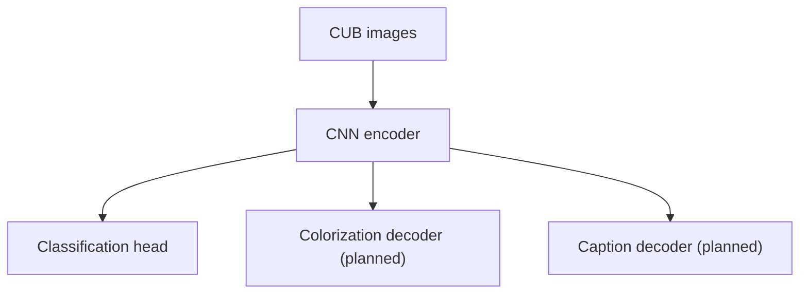

# FeatherLens

PyTorch project on **CUB-200-2011** exploring fine-grained bird classification first, with the learned CNN representations meant to support downstream colorization and image captioning.

## Classification Results

| Model | Val Top-1 | Test Top-1 | Macro F1 (Test) | Reference |
| --- | ---: | ---: | ---: | --- |
| ConvNeXt-Tiny + ConvNeXt-V2 Base ensemble (50/50 prob. avg) | 90.92% | 90.30% | 90.12% | [`docs/models.md`](docs/models.md#1-convnext-ensemble-9030-test-top-1) |
| iNaturalist2021 ResNet-50 (320px LDA head refit) | 87.92% | 87.54% | 87.62% | [`docs/models.md`](docs/models.md#2-inaturalist-resnet-50-8754-test-top-1) |
| Scratch CNN baseline & tuning | — | — | — | [`docs/classification_training_progress.md`](docs/classification_training_progress.md) |

Ensemble validation/test metrics are full-split measurements (`1,200` / `5,794`). A separate validation-only horizontal-flip TTA check reached `91.00%`; `94%` was not reached.

## Setup

Use Python 3.12 from the repository root:

```powershell
python -m venv .venv
.\.venv\Scripts\Activate.ps1   # Linux/macOS: source .venv/bin/activate

# CPU environment
pip install -r requirements.txt

# GPU environment (install matching CUDA PyTorch/torchvision first from pytorch.org)
pip install torch==2.11.0 torchvision==0.26.0 --index-url https://download.pytorch.org/whl/cu128
pip install -r requirements-gpu.txt
```

## Quick Commands

```powershell
# Ensemble CLI prediction, Grad-CAM, and evaluation (use --device cuda if available)
python -m src.cli predict --bundle classifier/bundle.json --image path/to/bird.jpg --device cpu
python -m src.cli gradcam --bundle classifier/bundle.json --image path/to/bird.jpg --component tiny --output outputs/cam.png --device cpu
python -m src.cli evaluate --bundle classifier/bundle.json --prepared-dir preparation --partition val --device cpu

# ResNet-50 training and evaluation
python -m src.resnet50.train --config configs/resnet50/inaturalist.yaml --train
python -m src.resnet50.evaluate --checkpoint path/to/model.pt --device cpu

# Exploratory data analysis
python -m src.eda.explore --full-training --split train

# Run test suite (set FEATHERLENS_PREPARED_DIR=preparation to include real-data check if cached)
python -m pytest -q
```

For scratch-CNN training, hyperparameter tuning, and `--checkpoint` CLI commands, see [`docs/classification_training_progress.md`](docs/classification_training_progress.md#integrated-cli-2026-11-03).

## Repository Layout

```text
featherlens/
├── bin/                   # Scratch-CNN convenience wrappers (train, tune, test)
├── configs/               # YAML / JSON configs (cls.yaml, pretrained_acceptance.json, resnet50/*.yaml)
├── docs/                  # Consolidated guides (data.md, eda.md, models.md, classification_training_progress.md)
├── notebooks/             # train_convnext.ipynb (Colab / Kaggle GPU training)
├── outputs/               # Ignored artifacts and local deliverables
├── preparation/           # Fixed 4,794 / 1,200 / 5,794 CUB classification split manifest
├── src/
│   ├── data/              # Hugging Face loaders, EXIF/RGB image I/O, integrity audit, split builder, transforms
│   ├── eda/               # Exploratory data analysis and figure generation
│   ├── models/            # Pretrained encoder adapters and scratch CNN architecture
│   ├── resnet50/          # Self-contained iNaturalist ResNet-50 train, head refit, search, eval, and Grad-CAM
│   ├── training/          # Pretrained trainer, checkpoints/weight verification, experiment runner, scratch trainer/tuning
│   ├── evaluation/        # Ensemble inference, metrics, and Grad-CAM
│   ├── visualization/     # Scratch CNN training plots and Grad-CAM helpers
│   └── cli.py             # Shared CLI entry point
├── tests/                 # Pytest suite mirroring src/
├── requirements.txt       # Pinned CPU dependencies
└── requirements-gpu.txt   # Non-torch dependencies for CUDA environments
```

## Target Architecture



## Documentation

- [`docs/data.md`](docs/data.md) — Pinned Hugging Face sources, image normalization, integrity audit, and fixed split rules
- [`docs/eda.md`](docs/eda.md) — Class distribution, geometry, color, and caption statistics across `5,994` training images
- [`docs/models.md`](docs/models.md) — ConvNeXt ensemble, iNaturalist ResNet-50 workflow, results, and encoder feature reuse
- [`docs/classification_training_progress.md`](docs/classification_training_progress.md) — Scratch CNN baseline, tuning log, and CLI reference
