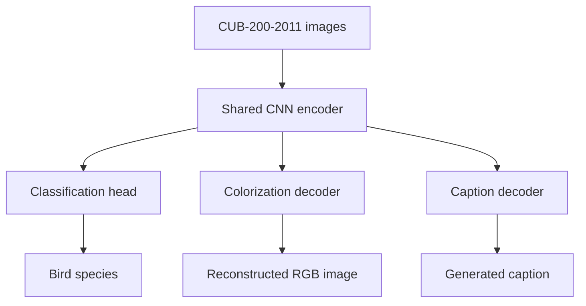

# From Pixels to Language

**A shared-encoder deep learning pipeline for image classification, colorization, and caption generation.**

Built with **PyTorch**, this project explores how visual representations learned for fine-grained image recognition can be reused for image reconstruction and natural-language generation. All three tasks are developed around a common convolutional neural network (CNN) encoder and evaluated on the **CUB-200-2011** bird dataset.

> **Development status:** Revision-pinned CUB source loading, the integrity audit, the classification data pipeline, and full statistical EDA are implemented. The ResNet-50 runner supports two-stage training, local MLflow tracking, checkpoint saving, selective fine-tuning and Mixup. Baseline/regularization experiments and logistic/discriminant classifier refits have validation reports and local exports. Two earlier exports have official-test evaluations. Formal grid/random search, a shared inference CLI, scratch-CNN integration, colorization, and captioning remain. See [training commands](docs/resnet50_training.md), [initial regularization results](docs/resnet50_regularization_results.md), [pipeline review and latest validation candidates](docs/resnet50_pipeline_review.md), and [earlier test results](docs/resnet50_test_results.md). CUB/ImageNet pretraining overlap is a known benchmark limitation and has not been audited here.

## Overview

| Task | Goal | Planned approach |
| --- | --- | --- |
| **Image classification** | Recognize 200 bird species | CNN trained from scratch, compared with transfer learning |
| **Image colorization** | Reconstruct color from a grayscale image | Encoder–decoder model reusing the trained visual backbone |
| **Image captioning** | Generate a natural-language image description | Frozen visual encoder with an autoregressive language decoder |

The central design goal is to **learn visual features once and adapt them across multiple tasks**, while keeping the data pipeline, models, training, and evaluation components independent and reusable.

## Architecture



The encoder is first trained and evaluated through classification. Subsequent tasks reuse the learned visual backbone: colorization uses grayscale inputs with an image decoder, while captioning uses a frozen encoder and a sequence decoder. The diagram represents the **target architecture**, not a currently running pipeline.

## Dataset

The project uses **Caltech–UCSD Birds-200-2011 (CUB-200-2011)** with associated text descriptions, available through Hugging Face:

- [Training split — `Multimodal-Fatima/CUB_train`](https://huggingface.co/datasets/Multimodal-Fatima/CUB_train)
- [Test split — `Multimodal-Fatima/CUB_test`](https://huggingface.co/datasets/Multimodal-Fatima/CUB_test)
- [Original CUB-200-2011 dataset](https://www.vision.caltech.edu/datasets/cub_200_2011/)

| Property | Value |
| --- | --- |
| Bird categories | 200 |
| Total images | 11,788 |
| Raw official training images | 5,994 |
| Derived classification training images | 4,794 |
| Derived validation images | 1,200 |
| Official test images | 5,794 |
| Captions per image (documented expectation) | 10 |

The source schema includes an image, its species label, and a `description` string. The full integrity audit verified ten structurally valid caption lines for every image in the pinned sources. The classification pipeline derives a reproducible validation partition from the official training split. Grayscale/RGB pairs for colorization remain planned. The official test split will be reserved for final evaluation.

**Dataset files are not included in this repository.**

### Available data foundation

The Stage 1 source loader pins both Hugging Face repositories to verified commits, checks their schemas and ordered class mappings, and exposes stable image IDs with linked caption records. A one-row streamed smoke test passed for each official split. The Stage 2 audit subsequently accounted for all 11,788 source rows, validated metadata and caption structure, fully decoded every image, and computed encoded-byte and normalized-pixel SHA-256 hashes. It found one exact duplicate pair within training and no exact duplicate group spanning the official train/test boundary. Audit-backed classification eligibility and reproducible training/validation manifests are now available.

```python
from src.data.source import load_cub_sources

sources = load_cub_sources(streaming=True)
image, captions = next(sources["train"].iter_records())
print(image.image_id, image.class_name, len(captions))
```

Use `streaming=True` for sequential inspection. The default downloads and caches the source data for later random access. Images remain undecoded source references in this interface; classification consumers use the separate lazy PyTorch interface described below. See [the data contract](docs/data_contract.md) for exact fields, revision pins, and verification limits.

### Available integrity audit

```python
from src.data.integrity_audit import audit_pinned_sources

summary = audit_pinned_sources("outputs/integrity-audit")
assert summary["coverage_complete"]
```

The audit writes image and caption manifests, exact duplicate groups, and an explicit coverage summary under the ignored `outputs/` directory. It preserves source data and original caption-line positions. See [the audit contract and verified findings](docs/integrity_audit.md) for quality flags, normalization rules, failure recovery, and Stage 3 consumption. Near-duplicate screening remains deferred; classification eligibility decisions are described below.

### Native image access for analysis

`read_source_image(source, source_row)` returns a raw indexed source row with a canonical image ID, original class metadata, native EXIF-corrected PIL RGB pixels, original/oriented dimensions, mode/profile/transparency facts, and recoverable failure status. It performs no resizing, filtering, training transforms, or source modification and requires no PyTorch or classification preparation. See [the shared image-access contract and training example](docs/image_access.md).

### Available statistical EDA

Statistical EDA covers all **5,994 raw official-training images and 59,940 captions**,
including the 1,200 derived-validation members. It includes class/caption
statistics, native-image measurements, lexical diversity and overlap, 13 PNG/PDF
figure groups, captioned galleries, and manifest-aware train/validation summaries.
Official test images and captions are excluded from statistical summaries.

Start metadata exploration from the repository root after installing the pinned
EDA dependencies:

```bash
python -m src.analysis.explore --full-training --split train
python -m src.visualization.eda_plots --report outputs/eda/reports/train-full.json --output-dir outputs/eda/figures
```

See [the EDA handoff](docs/eda_handoff.md) for the complete image/caption workflow,
verified preparation paths, report schemas, delivery inventory and limitations.
Reports and figures are generated under ignored `outputs/` directories and
distributed separately. **Fit any new data-derived preprocessing or vocabulary
parameters using only the 4,794 derived training records.**

### Available classification data pipeline

The EDA team's reviewed split metadata is now shared in
[`preparation/`](preparation/README.md). Both classification approaches can load
the same snapshot immediately after cloning, without regenerating the split:

```python
from src.data.preparation import load_classification_manifest

rows = load_classification_manifest("preparation")
```

The snapshot contains 4,794 training, 1,200 validation, and 5,794 official test
records. It includes provenance and a runnable batch example, but no image
assets. The ResNet-50 configuration points to this directory. To regenerate a
working preparation from a full audit instead, use an ignored output directory:

```python
from src.data.preparation import prepare_classification, load_classification_manifest

summary = prepare_classification("outputs/integrity-audit", "outputs/classification-v1")
rows = load_classification_manifest("outputs/classification-v1")
print(summary["partition_counts"])
```

Verified preparation produced **4,794 training, 1,200 validation, and 5,794 official test rows**, with no exclusions. Every class has six validation rows; training has 23–24 rows per class. Splitting is class-stratified with seed 42; both exact-duplicate Pigeon Guillemot rows remain together in validation. Original labels, captions, source assets, and test assignments are preserved.

The lazy Dataset returns `{"image": tensor, "label": class_id, "image_id": stable_id}`. Default preprocessing fits the entire EXIF-corrected RGB image into a centered white 224×224 canvas, preserving aspect ratio within pixel rounding. Horizontal flipping applies only to training. Normalization is configurable; the earlier crop profile is an explicit alternative. Real CPU batches, loss/backpropagation, and Windows two-worker loading have been verified.

Use Python 3.12 and [requirements-classification.txt](requirements-classification.txt) for the verified environment. See [the classification handoff](docs/classification_data.md) for installation, eligibility policy, split provenance, model-specific normalization, a Windows-safe batch example, and verification limits. Generated working artifacts under `outputs/`, environments, and caches remain ignored by Git; the reviewed shared `preparation/` snapshot is intended to be versioned.

## Project structure

```text
pixels-to-language/
├── configs/              # Experiment configurations
├── docs/                 # Technical documentation and research notes
├── notebooks/            # Exploratory analysis and experiments
├── outputs/              # Generated figures, logs, and checkpoints (gitignored)
├── preparation/          # Reviewed shared classification split and provenance
├── src/
│   ├── data/             # Dataset loading and preprocessing
│   ├── analysis/         # Statistical EDA and report generation
│   ├── models/           # Shared encoder and task-specific heads
│   ├── training/         # Training workflows
│   ├── evaluation/       # Metrics and benchmarking
│   ├── visualization/    # EDA plots; model explainability planned
│   └── utils/            # Shared utilities
├── tests/                # Automated tests
├── requirements-eda.txt  # Pinned statistical EDA dependencies
├── requirements-classification.txt  # Verified classification data dependencies
├── requirements.txt      # Anticipated model-training dependencies
└── README.md
```

Model, training and evaluation implementations remain planned. Statistical analysis and EDA visualization modules are available. The repository intentionally contains no model implementations or runnable training commands at this stage.

## Getting started

**Prerequisites:** Python 3.12 and Git for the verified data/EDA environment. A GPU is recommended for training once the pipeline is implemented.

From the repository root, create a virtual environment:

```bash
python -m venv .venv
```

Activate it on **Windows (PowerShell)**:

```powershell
.venv\Scripts\Activate.ps1
```

Or on **macOS / Linux**:

```bash
source .venv/bin/activate
```

For statistical EDA, install the pinned dependencies:

```bash
python -m pip install --upgrade pip
python -m pip install -r requirements-eda.txt
```

> For classification data and the complete repository test suite, follow [the pinned CPU setup and batch example](docs/classification_data.md). EDA-only tests run with `python -m pytest -q tests/analysis`; complete tests also require the classification dependencies. The broader `requirements.txt` remains an anticipated model-training dependency list. Training and prediction commands are not implemented.

### Planned CLI

The completed project will expose a consistent command-line interface for training and inference across all three tasks. For example, the intended usage will resemble:

```bash
# Planned commands — not yet implemented
python -m src.cli train --task classification --config configs/classification.yaml
python -m src.cli train --task colorization --config configs/colorization.yaml
python -m src.cli train --task caption --config configs/caption.yaml

python -m src.cli predict --task caption --image path/to/image.jpg
```

The actual commands and configuration files will be documented once the corresponding features exist.

## Development roadmap

- [x] **Data foundation:** Statistical EDA, source-preserving caption preparation, integrity audit, reproducible splits, transforms, and classification augmentation
- [ ] **Classification:** CNN baseline trained from scratch, transfer learning, and model comparison
- [ ] **Optimization and explainability:** Grid search, random search, experiment tracking, and Grad-CAM
- [ ] **Colorization:** Grayscale-to-color encoder–decoder model
- [ ] **Captioning:** Image-conditioned autoregressive caption generation
- [ ] **Evaluation and delivery:** Benchmarks, reproducible CLI workflows, documentation, and demonstration

### Evaluation strategy

| Task | Planned evaluation |
| --- | --- |
| Classification | Accuracy, precision, recall, F1-score, confusion matrix, Grad-CAM |
| Colorization | PSNR, MAE, qualitative comparisons against ground truth |
| Captioning | BLEU, ROUGE-L, generated captions compared with references |

Experiments will be tracked with **MLflow** or an equivalent tool. Reported results will be based on actual experiments and compared with relevant published or open-source baselines where a fair comparison is possible.

## Development guidelines

- Keep reusable functionality in Python modules; use notebooks for exploration only.
- Develop new features on focused branches and review changes through pull requests.
- Keep data, large checkpoints, local environments, and experiment artifacts out of Git.
- Include tests and update setup instructions when new functionality becomes available.
- Document experimental decisions and limitations alongside results.

## Acknowledgments

Developed as part of **CSE 485 / CSE 488 — Deep Learning**, Faculty of Engineering, **Ain Shams University**. The project specification is titled *From Pixels to Language*.

The dataset originates from the [Caltech–UCSD Birds-200-2011 project](https://www.vision.caltech.edu/datasets/cub_200_2011/), with caption annotations distributed through the Hugging Face datasets linked above.
