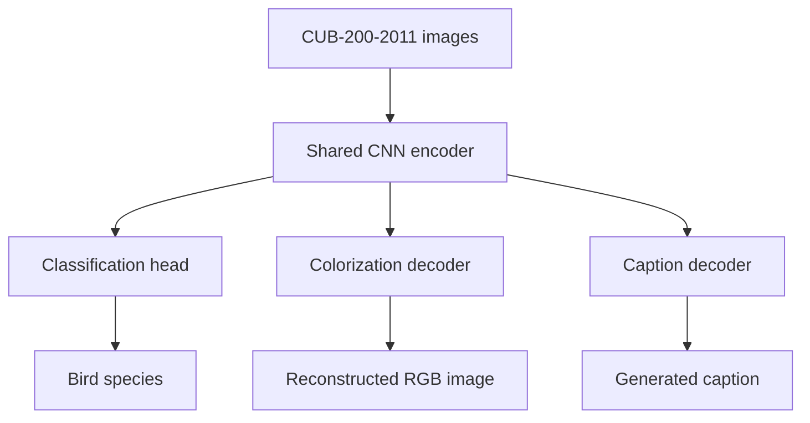

# From Pixels to Language

**A shared-encoder deep learning pipeline for image classification, colorization, and caption generation.**

Built with **PyTorch**, this project explores how visual representations learned for fine-grained image recognition can be reused for image reconstruction and natural-language generation. All three tasks are developed around a common convolutional neural network (CNN) encoder and evaluated on the **CUB-200-2011** bird dataset.

> **Development status:** The source/data foundation, integrity audit, classification pipeline and statistical EDA are implemented. The selected iNaturalist2021 ResNet-50 uses a 320px classifier refit and reached **87.92% validation and 87.54% test accuracy**. Training, MLflow tracking, evaluation, single-image prediction and Grad-CAM are implemented. The tuning-method comparison, scratch-CNN/benchmark comparisons and final delivery remain. The separate ConvNeXt-Tiny, EfficientNet-B3 and RegNetY-3.2GF pipeline provides verified GPU preflight, completed-epoch recovery and a cloud acceptance notebook; genuine canonical cloud-training results for that pipeline remain pending. See the [selected ResNet-50 workflow](docs/resnet50_training.md), [measured results](docs/resnet50_test_results.md) and [shared pretrained training guide](docs/pretrained_cnn_foundation.md).

## Overview

| Task | Goal | Planned approach |
| --- | --- | --- |
| **Image classification** | Recognize 200 bird species | CNN trained from scratch, compared with transfer learning |
| **Image colorization** | Reconstruct color from a grayscale image | Encoder–decoder model reusing the trained visual backbone |
| **Image captioning** | Generate a natural-language image description | Frozen visual encoder with an autoregressive language decoder |

The central design goal is to **learn visual features once and adapt them across multiple tasks**, while keeping the data pipeline, models, training, and evaluation components independent and reusable.

## Architecture



The encoder is first trained and evaluated through classification. Subsequent tasks reuse the learned visual backbone: colorization uses grayscale inputs with an image decoder, while captioning uses a frozen encoder and a sequence decoder. The diagram represents the **target architecture**, not a currently running pipeline.

## Dataset

The project uses **Caltech–UCSD Birds-200-2011 (CUB-200-2011)** with associated text descriptions, available through Hugging Face:

- [Training split — `Multimodal-Fatima/CUB_train`](https://huggingface.co/datasets/Multimodal-Fatima/CUB_train)
- [Test split — `Multimodal-Fatima/CUB_test`](https://huggingface.co/datasets/Multimodal-Fatima/CUB_test)
- [Original CUB-200-2011 dataset](https://www.vision.caltech.edu/datasets/cub_200_2011/)

| Property | Value |
| --- | --- |
| Bird categories | 200 |
| Total images | 11,788 |
| Raw official training images | 5,994 |
| Derived classification training images | 4,794 |
| Derived validation images | 1,200 |
| Official test images | 5,794 |
| Captions per image (documented expectation) | 10 |

The source schema includes an image, its species label, and a `description` string. The full integrity audit verified ten structurally valid caption lines for every image in the pinned sources. The classification pipeline derives a reproducible validation partition from the official training split. Grayscale/RGB pairs for colorization remain planned. Official test images are excluded from parameter fitting; completed ResNet evaluations and their limitations are recorded in the results report.

**Dataset files are not included in this repository.**

### Available data foundation

The Stage 1 source loader pins both Hugging Face repositories to verified commits, checks their schemas and ordered class mappings, and exposes stable image IDs with linked caption records. A one-row streamed smoke test passed for each official split. The Stage 2 audit subsequently accounted for all 11,788 source rows, validated metadata and caption structure, fully decoded every image, and computed encoded-byte and normalized-pixel SHA-256 hashes. It found one exact duplicate pair within training and no exact duplicate group spanning the official train/test boundary. Audit-backed classification eligibility and reproducible training/validation manifests are now available.

```python
from src.data.source import load_cub_sources

sources = load_cub_sources(streaming=True)
image, captions = next(sources["train"].iter_records())
print(image.image_id, image.class_name, len(captions))
```

Use `streaming=True` for sequential inspection. The default downloads and caches the source data for later random access. Images remain undecoded source references in this interface; classification consumers use the separate lazy PyTorch interface described below. See [the data contract](docs/data_contract.md) for exact fields, revision pins, and verification limits.

### Available integrity audit

```python
from src.data.integrity_audit import audit_pinned_sources

summary = audit_pinned_sources("outputs/integrity-audit")
assert summary["coverage_complete"]
```

The audit writes image and caption manifests, exact duplicate groups, and an explicit coverage summary under the ignored `outputs/` directory. It preserves source data and original caption-line positions. See [the audit contract and verified findings](docs/integrity_audit.md) for quality flags, normalization rules, failure recovery, and Stage 3 consumption. Near-duplicate screening remains deferred; classification eligibility decisions are described below.

### Native image access for analysis

`read_source_image(source, source_row)` returns a raw indexed source row with a canonical image ID, original class metadata, native EXIF-corrected PIL RGB pixels, original/oriented dimensions, mode/profile/transparency facts, and recoverable failure status. It performs no resizing, filtering, training transforms, or source modification and requires no PyTorch or classification preparation. See [the shared image-access contract and training example](docs/image_access.md).

### Available statistical EDA

Statistical EDA covers all **5,994 raw official-training images and 59,940 captions**,
including the 1,200 derived-validation members. It includes class/caption
statistics, native-image measurements, lexical diversity and overlap, 13 PNG/PDF
figure groups, captioned galleries, and manifest-aware train/validation summaries.
Official test images and captions are excluded from statistical summaries.

Start metadata exploration from the repository root after installing the pinned
EDA dependencies:

```bash
python -m src.analysis.explore --full-training --split train
python -m src.visualization.eda_plots --report outputs/eda/reports/train-full.json --output-dir outputs/eda/figures
```

See [the EDA handoff](docs/eda_handoff.md) for the complete image/caption workflow,
verified preparation paths, report schemas, delivery inventory and limitations.
Reports and figures are generated under ignored `outputs/` directories and
distributed separately. **Fit any new data-derived preprocessing or vocabulary
parameters using only the 4,794 derived training records.**

### Available classification data pipeline

The EDA team's reviewed split metadata is now shared in
[`preparation/`](preparation/README.md). Both classification approaches can load
the same snapshot immediately after cloning, without regenerating the split:

```python
from src.data.preparation import load_classification_manifest

rows = load_classification_manifest("preparation")
```

The snapshot contains 4,794 training, 1,200 validation, and 5,794 official test
records. It includes provenance and a runnable batch example, but no image
assets. The ResNet-50 configuration points to this directory. To regenerate a
working preparation from a full audit instead, use an ignored output directory:

```python
from src.data.preparation import prepare_classification, load_classification_manifest

summary = prepare_classification("outputs/integrity-audit", "outputs/classification-v1")
rows = load_classification_manifest("outputs/classification-v1")
print(summary["partition_counts"])
```

Verified preparation produced **4,794 training, 1,200 validation, and 5,794 official test rows**, with no exclusions. Every class has six validation rows; training has 23–24 rows per class. Splitting is class-stratified with seed 42; both exact-duplicate Pigeon Guillemot rows remain together in validation. Original labels, captions, source assets, and test assignments are preserved.

The lazy Dataset returns `{"image": tensor, "label": class_id, "image_id": stable_id}`. Default preprocessing fits the entire EXIF-corrected RGB image into a centered white 224×224 canvas, preserving aspect ratio within pixel rounding. Horizontal flipping applies only to training. Normalization is configurable; the earlier crop profile is an explicit alternative. Real CPU batches, loss/backpropagation, and Windows two-worker loading have been verified.

Use Python 3.12 and [requirements-classification.txt](requirements-classification.txt) for the verified environment. See [the classification handoff](docs/classification_data.md) for installation, eligibility policy, split provenance, model-specific normalization, a Windows-safe batch example, and verification limits. Generated working artifacts under `outputs/`, environments, and caches remain ignored by Git; the reviewed shared `preparation/` snapshot is intended to be versioned.

### Selected iNaturalist ResNet-50 workflow

The same ResNet-50 implementation supports two distinct pretraining choices:
`configs/resnet50.yaml` selects the earlier ImageNet baseline, while
`configs/resnet50_inaturalist.yaml` selects the authors' iNaturalist2021 checkpoint
trained without ImageNet initialization. Their weights and experiment outputs
are separate. The default runner configuration is the iNaturalist YAML;
the historical ImageNet baseline requires its explicit configuration.

After installing a suitable CUDA PyTorch build, install the workflow dependencies
and run from the repository root:

```powershell
.\.venv\Scripts\python.exe -m pip install -r requirements-resnet50.txt
.\.venv\Scripts\python.exe -m src.training.resnet50_runner --config configs/resnet50_inaturalist.yaml --check-batch
.\.venv\Scripts\python.exe -m src.training.resnet50_runner --config configs/resnet50_inaturalist.yaml --train
```

The iNaturalist pretraining file is an external input, verified against the
SHA-256 pinned in the configuration; its download instructions are in the
[training guide](docs/resnet50_training.md#inaturalist2021-pretraining-without-imagenet-initialization).
Training prints each unique output directory. The encoder was trained at 224px;
the selected final classifier was refitted at 320px using original and flipped
training views, with discriminant shrinkage 0.05. It reached **87.92% validation
and 87.54% test accuracy**; test macro precision/recall/F1 are
**88.29%/87.65%/87.62%**. Overfitting remains, and validation/test were inspected
across earlier experiments. See [selection and metrics](docs/resnet50_test_results.md)
and the [workflow/code map](docs/resnet50_training.md).

Prediction and explanation use the saved full checkpoint without retraining:

```powershell
.\.venv\Scripts\python.exe -m src.resnet50_predict --image "D:\birds\bird.jpg" --checkpoint "outputs/resnet50_inaturalist/augmented_pca_search/accuracy_challenger/model.pt" --device cpu --top-k 5
.\.venv\Scripts\python.exe -m src.visualization.resnet50_gradcam --image "D:\birds\bird.jpg" --checkpoint "outputs/resnet50_inaturalist/augmented_pca_search/accuracy_challenger/model.pt" --output "outputs/gradcam/bird.png" --device cpu
```

Replace the image path with your file. Grad-CAM saves a PNG and adjacent JSON;
add `--true-class-id N` only when the correct zero-based class label is known.

Model files, reports and local MLflow records are ignored by Git and delivered
separately. Keep model configuration and class mapping with Google Drive exports.
The ResNet encoder exposes spatial and pooled features for later project tasks.
This workflow uses its own runner; the shared JSON-based CLI below supports the
other pretrained adapters.

### Available pretrained CNN foundation

The Stage 1A adapters expose a shared classification and encoder interface for **ConvNeXt-Tiny, EfficientNet-B3, and RegNetY-3.2GF**. Each model produces 200 logits in the unchanged CUB class order and exposes spatial and pooled encoder features. Frozen, partial, and full fine-tuning policies preserve their parameter and normalization behavior across mode changes. A spatial target reference is available for future Grad-CAM integration; rendering remains planned.

```python
import torch

from src.models.pretrained import ModelConfig, create_pretrained_model

config = ModelConfig(architecture="convnext_tiny", fine_tuning="frozen")
model = create_pretrained_model(config, load_weights=False).eval()
with torch.no_grad():
    logits = model(torch.zeros(1, 3, 224, 224))
print(logits.shape)  # torch.Size([1, 200])
```

`load_weights=False` constructs an offline, randomly initialized encoder; it does not demonstrate pretrained quality. The default construction requests an explicit pinned torchvision weight enum and propagates loading errors. The prepared-data helper preserves the full-image 224-pixel fit profile and applies configurable normalization once; native weight crop recipes are metadata. See [the pretrained CNN guide](docs/pretrained_cnn_foundation.md) for exact weights, shapes, policy transitions, portable CPU setup, data integration, and verification limits.

### Official pretrained GPU preflight

Run [the Stage 1B-1 notebook](notebooks/pretrained/01_gpu_preflight.ipynb) on an online
Colab GPU using [the exact setup and evidence-return steps](docs/gpu_preflight.md).
It calls shared modules to verify official checkpoint hashes and retained backbone
tensors, then checks all three models sequentially across frozen/partial/full
policies, training backward checks, validation inference, supported AMP, memory and resident-batch inference
throughput. It performs no optimizer updates. Existing CUDA Torch/Torchvision are
inspected and preserved; canonical preparation metadata and pinned HF train images
are supplied separately. The small metadata handoff ZIP contains no images.

Returned T4 evidence verifies all three official checkpoints and 36/36 FP32/FP16
checks. A later targeted automatic-precision run passed 12/12 checks and storage
readback, selecting FP16 because this T4 lacks native BF16 support. PR 13 merged as
`6ad1adfe47f339414693c2034658a32bc6df2ca6`; the guide preserves the earlier failed
BF16 evidence and measurement limits. These preflight runs made zero optimizer updates.

### First classification training acceptance

Use [02_train_convnext.ipynb](notebooks/pretrained/02_train_convnext.ipynb) on online
Colab GPU, with the full published training PR SHA and verified metadata ZIP.
It preserves installed CUDA packages, mounts Drive and calls the shared trainer
with [pretrained_acceptance.json](configs/pretrained_acceptance.json): ConvNeXt-Tiny,
frozen two epochs, physical batch 8, accumulation 2, AdamW LR 0.001, FP16 and seed 42.
The stable Drive run directory supports explicit resume; keep the entire directory.
Return `run_summary.json` and `evidence.zip` for review. See the
[training/recovery guide](docs/pretrained_cnn_foundation.md#classification-training-and-recovery).
Local synthetic CPU tests establish orchestration/recovery only; real CUB training
accuracy, updates, duration and cloud restoration remain **PENDING**.

## Project structure

```text
pixels-to-language/
├── configs/              # Experiment configurations
├── docs/                 # Technical documentation and research notes
├── notebooks/            # Exploratory analysis and experiments
├── outputs/              # Generated figures, logs, and checkpoints (gitignored)
├── preparation/          # Reviewed shared classification split and provenance
├── src/
│   ├── data/             # Dataset loading and preprocessing
│   ├── analysis/         # Statistical EDA and report generation
│   ├── models/           # Shared encoder and task-specific heads
│   ├── training/         # Training workflows
│   ├── evaluation/       # Metrics and benchmarking
│   ├── visualization/    # EDA plots; model explainability planned
│   └── utils/            # Shared utilities
├── tests/                # Automated tests
├── requirements-eda.txt  # Pinned statistical EDA dependencies
├── requirements-classification.txt  # Verified classification data dependencies
├── requirements.txt      # Pinned CPU development/training dependencies
└── README.md
```

Model adapters, classification data integration, EDA, classification training,
validation metrics, checkpoint recovery and a runnable training CLI are available.

## Getting started

**Prerequisites:** Python 3.12 and Git for the verified CPU development environment.
Use a cloud GPU for the first canonical training acceptance.

From the repository root, create a virtual environment:

```bash
python -m venv .venv
```

Activate it on **Windows (PowerShell)**:

```powershell
.venv\Scripts\Activate.ps1
```

Or on **macOS / Linux**:

```bash
source .venv/bin/activate
```

For statistical EDA, install the pinned dependencies:

```bash
python -m pip install --upgrade pip
python -m pip install -r requirements-eda.txt
```

> For classification training and the complete test suite, follow [the pinned CPU setup](docs/pretrained_cnn_foundation.md#cpu-development-setup). `requirements.txt` includes the classification pins and `mlflow-skinny==3.17.2`. EDA-only tests run with `python -m pytest -q tests/analysis`. Cloud notebooks preserve their installed CUDA stack and install only missing non-Torch dependencies.

### Classification training CLI

From a compatible CUDA environment with canonical preparation available:

```bash
python -m src.cli train --task classification --config configs/pretrained_acceptance.json --prepared-dir outputs/classification-v1 --run-dir outputs/experiments/convnext-frozen-acceptance-v1 --device cuda
# Reuse that directory only with explicit recovery:
python -m src.cli train --task classification --config configs/pretrained_acceptance.json --prepared-dir outputs/classification-v1 --run-dir outputs/experiments/convnext-frozen-acceptance-v1 --device cuda --resume
```

Local MLflow tracking is the default; `--tracking json` explicitly selects portable
reports only. This shared JSON CLI currently supports training. ResNet-50 uses
the separate prediction and Grad-CAM commands above; colorization and caption
training commands remain planned.

## Development roadmap

- [x] **Data foundation:** Statistical EDA, source-preserving caption preparation, integrity audit, reproducible splits, transforms, and classification augmentation
- [x] **Pretrained CNN foundation:** Three model adapters, 200-class heads, encoder features, fine-tuning policies, and prepared train/validation integration; verified on CPU without pretrained weights
- [ ] **Classification:** CNN baseline trained from scratch, transfer learning, and model comparison
- [x] **ResNet-50 transfer workflow:** Staged training, classifier refit, MLflow, evaluation, prediction and Grad-CAM
- [ ] **Tuning comparison:** Reproducible grid-versus-random comparison with scores, budgets and timing
- [ ] **Colorization:** Grayscale-to-color encoder–decoder model
- [ ] **Captioning:** Image-conditioned autoregressive caption generation
- [ ] **Evaluation and delivery:** Benchmarks, reproducible CLI workflows, documentation, and demonstration

### Evaluation strategy

| Task | Planned evaluation |
| --- | --- |
| Classification | Accuracy, precision, recall, F1-score, confusion matrix, Grad-CAM |
| Colorization | PSNR, MAE, qualitative comparisons against ground truth |
| Captioning | BLEU, ROUGE-L, generated captions compared with references |

Classification experiments use local **MLflow** plus independent JSON/CSV reports.
Reported results must come from actual experiments; baseline comparisons remain planned.

## Development guidelines

- Keep reusable functionality in Python modules; use notebooks for exploration only.
- Develop new features on focused branches and review changes through pull requests.
- Keep data, large checkpoints, local environments, and experiment artifacts out of Git.
- Include tests and update setup instructions when new functionality becomes available.
- Document experimental decisions and limitations alongside results.

## Acknowledgments

Developed as part of **CSE 485 / CSE 488 — Deep Learning**, Faculty of Engineering, **Ain Shams University**. The project specification is titled *From Pixels to Language*.

The dataset originates from the [Caltech–UCSD Birds-200-2011 project](https://www.vision.caltech.edu/datasets/cub_200_2011/), with caption annotations distributed through the Hugging Face datasets linked above.
