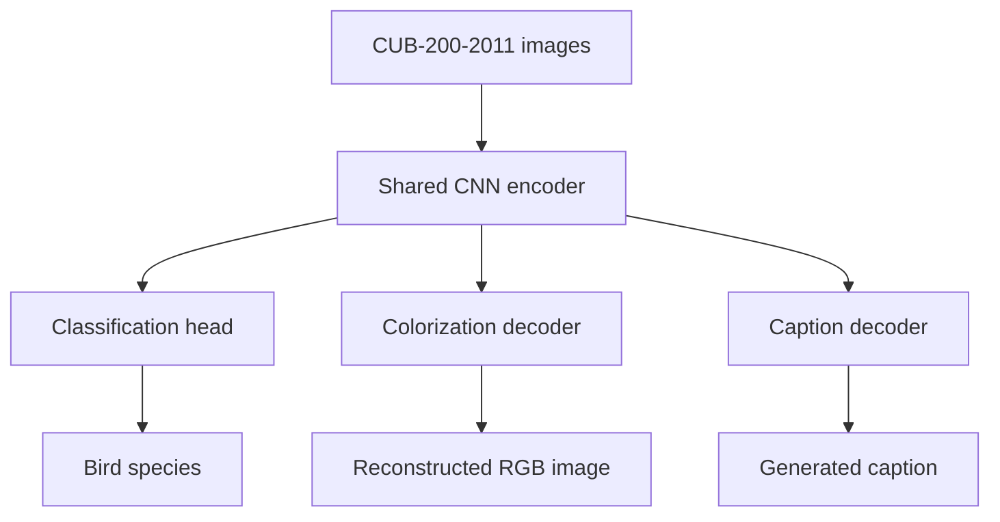

# From Pixels to Language

**A shared-encoder deep learning pipeline for image classification, colorization, and caption generation.**

Built with **PyTorch**, this project explores how visual representations learned for fine-grained image recognition can be reused for image reconstruction and natural-language generation. All three tasks are developed around a common convolutional neural network (CNN) encoder and evaluated on the **CUB-200-2011** bird dataset.

> **Development status:** Revision-pinned CUB source loading, schema validation, caption parsing, and a complete read-only integrity audit are implemented. The model architecture and experiments described below remain planned; model training, inference, and evaluation are not implemented yet.

## Overview

| Task | Goal | Planned approach |
| --- | --- | --- |
| **Image classification** | Recognize 200 bird species | CNN trained from scratch, compared with transfer learning |
| **Image colorization** | Reconstruct color from a grayscale image | Encoder–decoder model reusing the trained visual backbone |
| **Image captioning** | Generate a natural-language image description | Frozen visual encoder with an autoregressive language decoder |

The central design goal is to **learn visual features once and adapt them across multiple tasks**, while keeping the data pipeline, models, training, and evaluation components independent and reusable.

## Architecture



The encoder is first trained and evaluated through classification. Subsequent tasks reuse the learned visual backbone: colorization uses grayscale inputs with an image decoder, while captioning uses a frozen encoder and a sequence decoder. The diagram represents the **target architecture**, not a currently running pipeline.

## Dataset

The project uses **Caltech–UCSD Birds-200-2011 (CUB-200-2011)** with associated text descriptions, available through Hugging Face:

- [Training split — `Multimodal-Fatima/CUB_train`](https://huggingface.co/datasets/Multimodal-Fatima/CUB_train)
- [Test split — `Multimodal-Fatima/CUB_test`](https://huggingface.co/datasets/Multimodal-Fatima/CUB_test)
- [Original CUB-200-2011 dataset](https://www.vision.caltech.edu/datasets/cub_200_2011/)

| Property | Value |
| --- | --- |
| Bird categories | 200 |
| Total images | 11,788 |
| Training images | 5,994 |
| Test images | 5,794 |
| Captions per image (documented expectation) | 10 |

The source schema includes an image, its species label, and a `description` string. The full integrity audit verified ten structurally valid caption lines for every image in the pinned sources. Later preprocessing will create a validation partition from the official training split and grayscale/RGB pairs for colorization. The official test split will be reserved for final evaluation.

**Dataset files are not included in this repository.**

### Available data foundation

The Stage 1 source loader pins both Hugging Face repositories to verified commits, checks their schemas and ordered class mappings, and exposes stable image IDs with linked caption records. A one-row streamed smoke test passed for each official split. The Stage 2 audit subsequently accounted for all 11,788 source rows, validated metadata and caption structure, fully decoded every image, and computed encoded-byte and normalized-pixel SHA-256 hashes. It found one exact duplicate pair within training and no exact duplicate group spanning the official train/test boundary. Cleaning and splitting remain planned.

```python
from src.data.source import load_cub_sources

sources = load_cub_sources(streaming=True)
image, captions = next(sources["train"].iter_records())
print(image.image_id, image.class_name, len(captions))
```

Use `streaming=True` for sequential inspection. The default downloads and caches the source data for later random access. Images remain undecoded source references in this interface; classification transforms and PyTorch datasets are not implemented yet. See [the data contract](docs/data_contract.md) for exact fields, revision pins, and verification limits.

### Available integrity audit

```python
from src.data.integrity_audit import audit_pinned_sources

summary = audit_pinned_sources("outputs/integrity-audit")
assert summary["coverage_complete"]
```

The audit writes image and caption manifests, exact duplicate groups, and an explicit coverage summary under the ignored `outputs/` directory. It preserves source data and original caption-line positions. See [the audit contract and verified findings](docs/integrity_audit.md) for quality flags, normalization rules, failure recovery, and Stage 3 consumption. Near-duplicate screening and cleaning decisions are not implemented.

### Native image access for analysis

`read_source_image(source, source_row)` returns a raw indexed source row with a canonical image ID, original class metadata, native EXIF-corrected PIL RGB pixels, original/oriented dimensions, mode/profile/transparency facts, and recoverable failure status. It performs no resizing, filtering, training transforms, or source modification and requires no PyTorch or classification preparation. See [the shared image-access contract and training example](docs/image_access.md).

## Project structure

```text
pixels-to-language/
├── configs/              # Experiment configurations
├── docs/                 # Technical documentation and research notes
├── notebooks/            # Exploratory analysis and experiments
├── outputs/              # Generated figures, logs, and checkpoints (gitignored)
├── src/
│   ├── data/             # Dataset loading and preprocessing
│   ├── models/           # Shared encoder and task-specific heads
│   ├── training/         # Training workflows
│   ├── evaluation/       # Metrics and benchmarking
│   ├── visualization/    # Plots and model explainability
│   └── utils/            # Shared utilities
├── tests/                # Automated tests
├── requirements.txt      # Initial dependency list
└── README.md
```

Model, training, evaluation, and visualization directories remain placeholders for future development. The repository intentionally contains no model implementations or runnable training commands at this stage.

## Getting started

**Prerequisites:** Python 3.11+ and Git. A GPU is recommended for training once the pipeline is implemented.

From the repository root, create a virtual environment and install the preliminary dependencies:

```bash
python -m venv .venv
```

Activate it on **Windows (PowerShell)**:

```powershell
.venv\Scripts\Activate.ps1
```

Or on **macOS / Linux**:

```bash
source .venv/bin/activate
```

Then install the dependencies:

```bash
python -m pip install --upgrade pip
pip install -r requirements.txt
```

> The dependency list is preliminary and will be version-pinned as development progresses. **Installation prepares the environment only**; training and prediction commands are not available in this scaffold.

### Planned CLI

The completed project will expose a consistent command-line interface for training and inference across all three tasks. For example, the intended usage will resemble:

```bash
# Planned commands — not yet implemented
python -m src.cli train --task classification --config configs/classification.yaml
python -m src.cli train --task colorization --config configs/colorization.yaml
python -m src.cli train --task caption --config configs/caption.yaml

python -m src.cli predict --task caption --image path/to/image.jpg
```

The actual commands and configuration files will be documented once the corresponding features exist.

## Development roadmap

- [ ] **Data foundation:** Exploratory data analysis, caption cleaning, data splits, transforms, and augmentation
- [ ] **Classification:** CNN baseline trained from scratch, transfer learning, and model comparison
- [ ] **Optimization and explainability:** Grid search, random search, experiment tracking, and Grad-CAM
- [ ] **Colorization:** Grayscale-to-color encoder–decoder model
- [ ] **Captioning:** Image-conditioned autoregressive caption generation
- [ ] **Evaluation and delivery:** Benchmarks, reproducible CLI workflows, documentation, and demonstration

### Evaluation strategy

| Task | Planned evaluation |
| --- | --- |
| Classification | Accuracy, precision, recall, F1-score, confusion matrix, Grad-CAM |
| Colorization | PSNR, MAE, qualitative comparisons against ground truth |
| Captioning | BLEU, ROUGE-L, generated captions compared with references |

Experiments will be tracked with **MLflow** or an equivalent tool. Reported results will be based on actual experiments and compared with relevant published or open-source baselines where a fair comparison is possible.

## Development guidelines

- Keep reusable functionality in Python modules; use notebooks for exploration only.
- Develop new features on focused branches and review changes through pull requests.
- Keep data, large checkpoints, local environments, and experiment artifacts out of Git.
- Include tests and update setup instructions when new functionality becomes available.
- Document experimental decisions and limitations alongside results.

## Acknowledgments

Developed as part of **CSE 485 / CSE 488 — Deep Learning**, Faculty of Engineering, **Ain Shams University**. The project specification is titled *From Pixels to Language*.

The dataset originates from the [Caltech–UCSD Birds-200-2011 project](https://www.vision.caltech.edu/datasets/cub_200_2011/), with caption annotations distributed through the Hugging Face datasets linked above.
